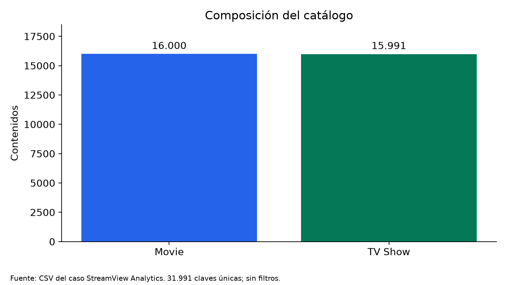
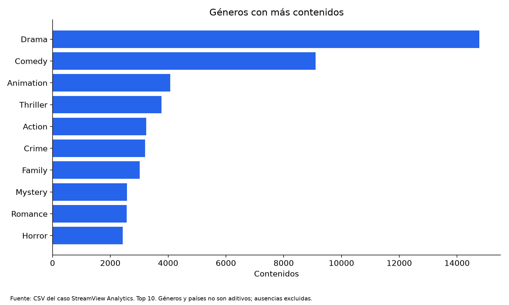
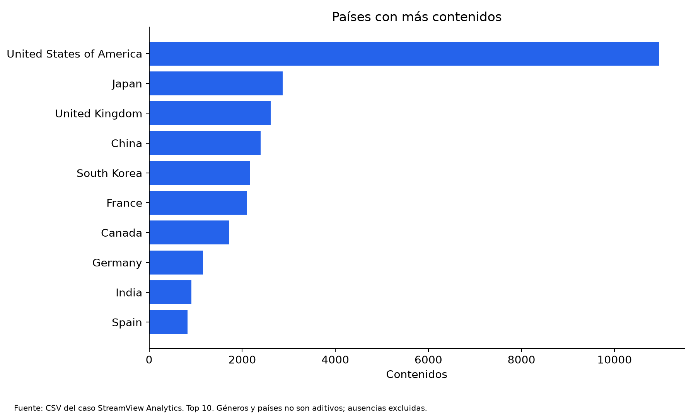
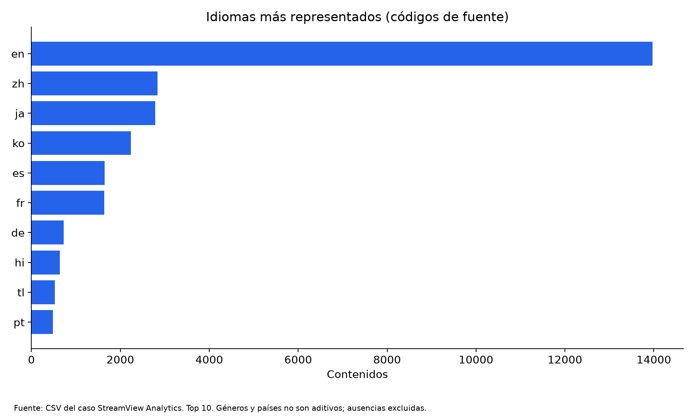
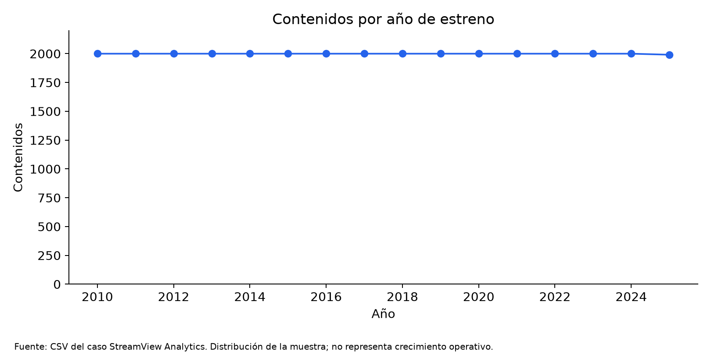
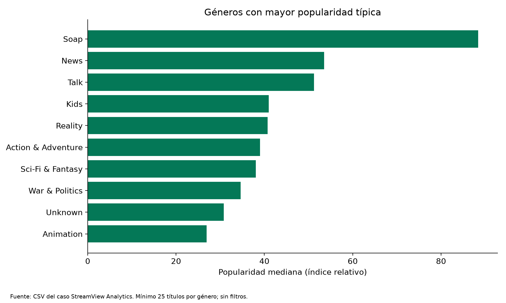

# Informe ejecutivo — StreamView Analytics

## StreamView Analytics

### Análisis del catálogo y diseño de una solución interactiva en Power BI

**Asignatura:** ADY1104 — Visualización de Datos
**Integrantes:** Betsabe Spring y David Zúñiga
**Profesor:** Oscar Oliva
**Fecha de elaboración:** 12/10/2026
**Entrega:** Encargo EP3 y apoyo a la presentación y defensa EP4
**Estado:** Borrador con preparación y análisis verificados en Python; implementación y validación de Power BI pendientes.

> **INSTRUCCIÓN DE EDICIÓN — RETIRAR ANTES DE ENTREGAR:** Todos los bloques identificados como **[PENDIENTE POWER BI — PBxx]** deben completarse con evidencia del archivo construido. No reemplazar esos bloques por afirmaciones de cumplimiento sin verificar. Las instrucciones de edición y el estado de borrador se retiran al cerrar el informe. Confirmar integrantes y fecha final de entrega.

## Resumen ejecutivo

StreamView Analytics necesita una lectura consolidada del catálogo para apoyar decisiones de adquisición, revisión editorial y promoción. El proyecto integra los dos archivos de películas y series proporcionados por el profesor y prepara una solución de visualización mediante Python y Power BI.

La base corregida contiene **31.991 contenidos**, distribuidos en **16.000 películas y 15.991 series**, con años de estreno entre **2010 y 2025**. La revisión detectó que los identificadores originales no son únicos entre tipos: 397 identificadores corresponden tanto a una película como a una serie distinta. La nueva clave compuesta conserva ambos contenidos. Solo se descartan nueve observaciones repetidas de series, mediante una regla documentada.

Drama es el género más representado, con 14.769 títulos asociados. Sin embargo, las categorías con mayor popularidad típica difieren de las más abundantes, lo que justifica separar composición y desempeño. La valoración válida promedio es **6,63 sobre 10**, con cobertura del **85,7 %** del catálogo. Solo **3.540 películas**, equivalentes al **22,1 %** de las películas, disponen de presupuesto e ingresos positivos.

El diseño propone cuatro páginas: Resumen, Catálogo, Popularidad y valoración, y Finanzas de películas. La recomendación principal es utilizar la solución para seleccionar segmentos y títulos que ameriten revisión, acompañando cada indicador con sus restricciones. Los datos no permiten medir retención, reproducciones, comportamiento individual de usuarios ni rentabilidad de StreamView.

> **[PENDIENTE POWER BI — PB01]** Completar este resumen con el estado real del dashboard: páginas efectivamente implementadas, resultado de la validación y una conclusión breve sobre su utilidad comprobada. Hasta entonces, conservar la expresión «el diseño propone».

## 1. Descripción del problema de negocio

### 1.1 Contexto y necesidad

El caso presenta una plataforma de streaming con un catálogo amplio y reportes fragmentados. Las áreas de contenidos y marketing necesitan comparar categorías, países y títulos mediante criterios consistentes. Una visualización consolidada permite pasar de listados extensos a preguntas de negocio concretas: qué predomina, qué destaca por popularidad o valoración y dónde existen candidatos para revisión editorial.

El problema que aborda esta entrega es: **¿cómo integrar y comunicar los metadatos disponibles del catálogo para apoyar la adquisición y priorización de contenidos mediante una solución visual interactiva?**

### 1.2 Alcance con los datos entregados

Se utilizan exclusivamente los CSV proporcionados por el profesor. Aunque las pautas EP3 y EP4 describen también usuarios, reproducciones, suscripciones y dispositivos, esas fuentes no forman parte de los archivos entregados. Por ello, el análisis se limita al catálogo y sus métricas disponibles, sin inventar datos ni presentar popularidad o votos como sustitutos de consumo real.

Las decisiones apoyadas son la revisión de géneros y países para adquisiciones, identificación de títulos candidatos a promoción y comparación exploratoria de películas con información financiera. La decisión final requiere antecedentes editoriales, comerciales y de costos ausentes en esta base.

## 2. Objetivos del proyecto

### 2.1 Objetivo general

Preparar y diseñar una solución de Visual Analytics que integre el catálogo de StreamView Analytics y comunique evidencia relevante para decisiones de contenidos, mediante datos reproducibles en Python y un informe interactivo en Power BI.

> **[PENDIENTE POWER BI — PB02]** Una vez terminada y comprobada la solución, actualizar el objetivo y la descripción del alcance para reflejar su implementación efectiva.

### 2.2 Objetivos específicos

- Integrar películas y series preservando su identidad y trazabilidad.
- Documentar valores faltantes, repeticiones y restricciones semánticas.
- Caracterizar el catálogo por tipo, género, país, idioma y año de estreno.
- Comparar popularidad y valoración sin confundirlas con consumo.
- Analizar presupuesto e ingresos únicamente en películas con datos válidos.
- Implementar KPIs, segmentadores, navegación e interacción orientados a la audiencia.
- Justificar las representaciones y comunicar hallazgos con una narrativa clara.
- Evaluar la solución y formular recomendaciones sustentadas en evidencia.

## 3. Audiencia objetivo y propósito comunicacional

La audiencia principal es la **Gerencia de Contenidos y Adquisición**, que necesita explorar segmentos y revisar oportunidades. El **Directorio y la Gerencia General** requieren una síntesis del catálogo y sus limitaciones. **Marketing** necesita identificar candidatos a promoción a partir de señales de popularidad y valoración. El equipo de **Data & Analytics** necesita reproducibilidad y consistencia de indicadores.

La comunicación seguirá un recorrido desde una visión general hacia la comparación de categorías y la revisión de títulos. Los indicadores deben responder preguntas concretas y permitir entender qué población representan. Coberturas y alertas acompañan los resultados para evitar que una cifra aislada parezca una recomendación automática.

## 4. Fuentes de datos, integración y calidad

### 4.1 Fuentes oficiales de trabajo

| Archivo entregado | Filas originales | Variables originales |
| --- | ---: | ---: |
| `netflix_movies_detailed_up_to_2025.csv` | 16.000 | 18 |
| `netflix_tv_shows_detailed_up_to_2025.csv` | 16.000 | 16 |

Los archivos contienen identificación, título, director, reparto, países, fecha declarada de incorporación, año de estreno, duración, géneros, idioma, descripción, popularidad, votos y calificación. Presupuesto e ingresos están disponibles solo para películas. Su uso se fundamenta en la entrega del caso; no se atribuye una procedencia externa o licencia que no esté documentada.

### 4.2 Preparación reproducible

El script `src/main.py` carga ambas fuentes, valida estructura y valores, conserva identificadores como texto, normaliza espacios y tipos y genera derivados en `data/processed/`. Mantiene intactos los CSV originales de `data/raw/`. Las huellas SHA-256 registradas en `resumen_calidad.json` permiten identificar las fuentes utilizadas.

La integración usa `content_id`, con prefijo `movie:` o `tv:` y el identificador original. Los 397 identificadores compartidos corresponden a contenidos distintos entre tipos. Por ejemplo, el identificador 38234 aparece en la película *Undisputed III: Redemption* y la serie *Lives of Omission*. Deduplicar solo por `show_id` habría descartado una de ellas.

Dentro de series existen nueve grupos repetidos, cada uno con dos filas que difieren solamente en popularidad. Se conserva la primera observación según el orden del archivo, sin atribuirle mayor actualidad. Las 18 filas y la selección se exportan como evidencia. La base final contiene 31.991 claves únicas.

Géneros y países se separan en dimensiones y tablas de asociación con pares únicos. Hay **66.967 asociaciones de género** y **39.889 de país**, incluyendo las ausencias etiquetadas como «Sin información». Un contenido puede pertenecer a varias categorías; las asociaciones no equivalen al total de contenidos.

### 4.3 Restricciones de calidad

| Observación verificada | Tratamiento y efecto |
| --- | --- |
| `rating` replica `vote_average` en las 32.000 filas originales. | Se excluye del catálogo analítico; no se interpreta como clasificación etaria. |
| El año de `date_added` coincide con `release_year` en las 32.000 filas. | Se conserva la fecha y su advertencia; las tendencias se basan en estreno. La coincidencia no demuestra por sí sola que la fecha sea incorrecta. |
| Las 16.000 películas carecen de duración. | No se comparan minutos de películas con temporadas de series. |
| 11.092 contenidos sin director, 1.360 sin reparto, 2.261 sin país y 1.079 sin género. | Se conservan nulos; no se imputan identidades o categorías. |
| 4.564 títulos con valoración cero. | Se excluyen del promedio válido; no se interpretan como rechazo del público. |
| 55 películas con presupuesto positivo menor a 1.000. | Se marca una alerta provisional de revisión; no se corrigen ni eliminan automáticamente. |

Presupuesto e ingresos no positivos se tratan como información no disponible en los derivados. La razón financiera solo existe cuando ambos valores son positivos y el contenido es una película. No se asume una moneda sin documentación.

## 5. Análisis exploratorio mediante visualizaciones

Las cifras de esta sección se calcularon en Python sobre el catálogo preparado. Describen el conjunto entregado y no deben extrapolarse a todo el mercado audiovisual o al comportamiento de usuarios.

### 5.1 Composición y cobertura

| Indicador | Resultado |
| --- | ---: |
| Contenidos | 31.991 |
| Películas | 16.000 (50,0 %) |
| Series | 15.991 (50,0 %) |
| Géneros conocidos presentes | 28 |
| Países conocidos presentes | 147 |
| Idiomas presentes | 83 |
| Contenidos con valoración válida | 27.427 (85,7 %) |
| Contenidos elegibles para ranking de valoración | 11.805 |

La composición equilibrada permite contrastar ambos formatos, siempre que las variables sean comparables. Las categorías de género y país requieren conteos distintos por contenido.

*Visualización estática generada en Python sobre el catálogo preparado; no es una captura de Power BI.*

> **[PENDIENTE POWER BI — PB03]** Insertar Figura 1: barras de películas y series con cantidades y alcance. Registrar archivo de imagen y pie: «Fuente: CSV del caso, preparación StreamView en Python y visualización en Power BI». Comprobar concordancia con la tabla anterior.

### 5.2 Concentración temática, países e idiomas

| Género | Contenidos asociados |
| --- | ---: |
| Drama | 14.769 |
| Comedy | 9.105 |
| Animation | 4.069 |
| Thriller | 3.769 |
| Action | 3.239 |

Entre los países conocidos destacan United States of America (10.955), Japan (2.869), United Kingdom (2.608) y China (2.399). Los códigos de idioma más frecuentes son `en` (13.969), `zh` (2.834), `ja` (2.784), `ko` (2.240) y `es` (1.646).

Estos resultados describen la oferta disponible en la muestra. Un país de producción no identifica la ubicación de la audiencia ni demuestra demanda en ese mercado. La mayor representación de un género tampoco implica que adquirir más títulos de ese género sea la mejor decisión.

*Visualización estática generada en Python sobre el catálogo preparado; no es una captura de Power BI.*

*Los países y géneros admiten asociaciones múltiples; los códigos de idioma conservan las etiquetas de fuente.*

> **[PENDIENTE POWER BI — PB04]** Insertar Figura 2: comparación por género y país, y Figura 3: treemap de idiomas. Identificar Top N, nulos excluidos y filtros utilizados. Añadir pies que adviertan que las categorías de género y país no son aditivas.

### 5.3 Distribución temporal

El catálogo final contiene **2.000 contenidos por año entre 2010 y 2024**, y **1.991 en 2025**. La uniformidad es una propiedad del conjunto entregado y puede reflejar su selección; no hay información suficiente para explicar su origen. Los nueve registros repetidos descartados pertenecen al año 2025.

La visualización temporal debe mostrar la distribución de estrenos de la muestra. No permite afirmar crecimiento del catálogo operativo, variaciones de demanda o incorporación real a la plataforma.

*Visualización estática generada en Python sobre el catálogo preparado; no es una captura de Power BI.*

> **[PENDIENTE POWER BI — PB05]** Insertar Figura 4: línea «Contenidos por año de estreno», con eje 2010–2025. Evitar interpretar la reducción de nueve registros como caída del negocio.

### 5.4 Popularidad y valoración

| Métrica | Catálogo | Películas | Series |
| --- | ---: | ---: | ---: |
| Popularidad mediana | 22,071 | 10,914 | 36,200 |
| Valoración promedio válida | 6,63 | 6,31 | 7,03 |
| Cobertura de valoración | 85,7 % | 94,4 % | 77,1 % |

Las series presentan mayor mediana de popularidad y mayor valoración promedio válida en esta muestra. Sin embargo, su cobertura de valoración es menor y los formatos pueden tener características distintas. Estos resultados no prueban que las series produzcan más retención o ingresos para la plataforma.

La popularidad mediana por género, restringida a categorías con al menos 25 títulos, destaca Soap (88,398; 631 títulos), News (53,556; 113) y Talk (51,244; 654). Estas categorías difieren de las más abundantes, mostrando que composición y popularidad responden a preguntas distintas. Las métricas de género incluyen asociaciones y no deben sumarse entre categorías.

Los rankings de valoración requieren calificación positiva y al menos 100 votos. El umbral reduce la selección de casos con escaso respaldo, pero no elimina sesgos. El promedio válido es un promedio por título y no está ponderado por votos. Los 13.210.726 votos registrados no representan usuarios únicos.

*Visualización estática generada en Python sobre el catálogo preparado; no es una captura de Power BI.*

> **[PENDIENTE POWER BI — PB06]** Insertar Figura 5: popularidad mediana por género, con tamaño de muestra. Insertar Figura 6: dispersión de popularidad y valoración. Describir la relación solo después de revisar el gráfico final y su población; no afirmar causalidad ni una correlación estadística no calculada. Añadir ranking final de candidatos con filtros, criterio y votos visibles.

### 5.5 Finanzas y anomalías

Solo **3.540 de las 16.000 películas (22,125 %)** tienen presupuesto e ingresos positivos. Dentro de esa misma población, la suma de presupuestos es **125.960.767.278** y la suma de ingresos **367.371.433.138**, en la unidad monetaria no documentada de la fuente. La razón entre ambas sumas es **2,917 veces**.

Esta razón no equivale al promedio de razones por película, ni representa beneficio neto. No incorpora marketing, distribución, licencias o costos operacionales. Tampoco corresponde a ingresos o rentabilidad de StreamView.

De las 55 películas con presupuesto marcado para revisión, diez pertenecen a la población financiera válida. En esas diez, los presupuestos suman 925 y los ingresos 15.009.450, generando una razón agregada de 16.226,43 veces. Este resultado ilustra por qué los retornos extremos requieren revisión y no deben convertirse directamente en recomendaciones de inversión. El umbral de 1.000 es una alerta analítica del equipo, no una regla impuesta por la pauta ni evidencia definitiva de error.

> **[PENDIENTE POWER BI — PB07]** Insertar Figura 7: dispersión de presupuesto e ingresos y tabla de razones por título, con alertas. Confirmar cobertura general de 22,1 % y que la página no filtre globalmente solo películas válidas, lo que falsearía el denominador de cobertura. Documentar la selección y la unidad sin agregar símbolo monetario.

## 6. Justificación de las representaciones gráficas

| Representación propuesta | Uso | Justificación y precaución |
| --- | --- | --- |
| Tarjetas KPI | Volumen, medianas, valoración y cobertura. | Facilitan la lectura inicial. Requieren etiquetas y universo explícitos. |
| Barras | Tipos, géneros, países y rankings. | Permiten comparar magnitudes por posición y longitud. Orden descendente y Top N identificado. |
| Línea | Contenidos por año de estreno. | Conserva el orden temporal; muestra la distribución de la muestra, sin inferir crecimiento operativo. |
| Treemap | Composición por idioma. | Presenta participación relativa de categorías; complementar con cantidades y códigos identificables. |
| Dispersión | Popularidad–valoración y presupuesto–ingresos. | Permite explorar relaciones y valores extremos. Identificar cada contenido y documentar escalas y población. |
| Tabla de detalle | Candidatos y alertas financieras. | Preserva valores exactos, votos y trazabilidad para revisión. |

Se propone fondo claro, tipografía legible, títulos directos y colores consistentes: azul para películas, verde para series y naranja para alertas. Las advertencias incluyen texto para no depender exclusivamente del color. La jerarquía separa síntesis, comparación y detalle. Las leyendas, escalas y títulos deben evitar ambigüedades.

> **[PENDIENTE POWER BI — PB08]** Actualizar esta tabla con los gráficos realmente utilizados. Justificar cualquier sustitución, agregar evidencia de legibilidad y confirmar que etiquetas, leyendas y colores se mantengan consistentes en el informe y exportaciones.

## 7. Narrativa visual — Data Storytelling

La narrativa responde a las preguntas del caso sin exceder la evidencia disponible:

1. **¿Qué está ocurriendo?** La muestra tiene una oferta equilibrada entre películas y series, con concentración temática en Drama y Comedy y una presencia importante de producciones asociadas a Estados Unidos.
2. **¿Por qué merece atención?** Abundancia, popularidad y valoración muestran dimensiones diferentes. Un género numeroso no necesariamente presenta la mayor popularidad típica. Los datos no explican causalmente las preferencias del público.
3. **¿Qué evidencia lo demuestra?** Los conteos por categoría, medianas y coberturas permiten comparar esas dimensiones. La revisión financiera muestra además que solo una parte de las películas admite el análisis.
4. **¿Qué decisiones apoyar?** Revisar segmentos y títulos que combinen señales relevantes, evitando comprometer adquisiciones o campañas únicamente por un ranking. Verificar las anomalías y complementar con consumo y costos cuando existan.

El mensaje central es: **la priorización del catálogo necesita comparar señales distintas y conocer la calidad de los datos que las sostienen**.

El recorrido propuesto inicia en Resumen, explora concentración en Catálogo, compara señales en Popularidad y valoración y termina en Finanzas de películas. Así se avanza desde contexto hacia posibles candidatos y restricciones.

> **[PENDIENTE POWER BI — PB09]** Seleccionar un ejemplo real de exploración que conecte filtros, visualizaciones y una recomendación concreta. Registrar selección, cifras y título elegido. No escribir una acción comercial definitiva sin evidencia suficiente.

## 8. Diseño e implementación del dashboard interactivo

### 8.1 Herramientas y responsabilidades

Python se utiliza para integración, limpieza, controles de calidad y generación de tablas reutilizables. Power BI se selecciona para la construcción del informe interactivo, medidas DAX y exploración visual. La preparación queda separada de la construcción para que ambos integrantes utilicen la misma base y definiciones.

La implementación de Power BI se realiza en el PC de la integrante encargada. Esta organización permite avanzar con datos, análisis y documentación desde el equipo Linux del otro integrante. El notebook documenta la exploración del catálogo preparado y complementa el código reproducible. La evidencia del dashboard debe corresponder al archivo Power BI construido.

### 8.2 Modelo diseñado

El modelo utiliza catálogo, dimensiones de género, país y año de estreno, y dos tablas de asociación. La clave única es `content_id`. Las cinco relaciones son 1:*; las relaciones entre catálogo y asociaciones se definen con filtrado en ambas direcciones, mientras las dimensiones filtran sus asociaciones en una dirección. No se añaden rutas alternativas ni se multiplican filas mediante una unión plana.

Se definieron 23 medidas DAX. Los filtros de elegibilidad se intersectan con las selecciones actuales para que seleccionar series no devuelva resultados financieros de películas. Los indicadores financieros utilizan la misma población válida en numerador y denominador.

> **[PENDIENTE POWER BI — PB10]** Registrar nombre y versión del archivo PBIX, versión de Power BI utilizada, fecha de actualización y ruta o parámetro de fuentes. Insertar captura del modelo y confirmar cardinalidades, direcciones, tipos y ausencia de relaciones automáticas adicionales. Registrar ajustes reales respecto del diseño.

### 8.3 Páginas y funcionalidad prevista

| Página diseñada | Audiencia y función |
| --- | --- |
| Resumen | Directorio: volumen, composición y distribución temporal. |
| Catálogo | Contenidos: comparación de géneros, países e idiomas. |
| Popularidad y valoración | Contenidos y Marketing: señales complementarias y rankings. |
| Finanzas de películas | Directorio y Contenidos: cobertura, comparaciones y revisión de anomalías. |

Los segmentadores comunes corresponden a tipo, género, país, idioma y año. Las selecciones dentro de una dimensión se combinan como alternativas y entre dimensiones por intersección. El diseño incorpora navegación entre páginas, sincronización de segmentadores, filtrado entre gráficos y limpieza de selecciones. El filtro de revisión financiera se limita a su página.

> **[PENDIENTE POWER BI — PB11]** Insertar capturas de las cuatro páginas implementadas. Describir qué filtros se sincronizan, qué interacción ocurre al seleccionar una barra, cómo se navega y cómo se restablece el estado. Confirmar que los segmentos vacíos muestran conteos cero y métricas sin datos, y que no existen filtros ocultos que alteren resultados.

### 8.4 Reproducibilidad y validación

El proyecto incluye dos scripts: `src/main.py` prepara las tablas y `src/referencias_kpis.py` genera controles para once escenarios. Las ejecuciones de preparación desde distintas carpetas produjeron salidas idénticas, conservando las fuentes originales. Se verificaron claves únicas, referencias de asociaciones y reglas financieras.

| Contexto de referencia en Python | Contenidos | Películas financieras válidas |
| --- | ---: | ---: |
| Sin filtros | 31.991 | 3.540 |
| Series | 15.991 | 0 |
| Drama + Japan | 1.084 | 27 |
| Drama o Comedy + Japan | 1.872 | 47 |
| Estrenos 2020–2025 | 11.991 | 862 |

Estos controles validan la preparación y ofrecen resultados esperados. No demuestran que las relaciones y las medidas se hayan ejecutado correctamente en Power BI.

> **[PENDIENTE POWER BI — PB12]** Comparar los once escenarios de `referencia_kpis.csv` con el PBIX. Añadir tabla de esperado/obtenido/resultado, evidencia de los filtros usados y explicación de diferencias. Registrar pruebas de navegación, filtros combinados, ausencia de datos y selección de series en Finanzas. Indicar quién verificó y en qué fecha.

> **[PENDIENTE POWER BI — PB13]** Registrar exportaciones finales, calidad de capturas, legibilidad del PDF y prueba de apertura y actualización del proyecto en el PC de entrega. Comprobar que los productos estén completos y documentados; no declarar publicación en línea si no se realizó.

## 9. Evaluación crítica: fortalezas, limitaciones y mejoras

### 9.1 Fortalezas comprobadas de la preparación

La clave compuesta corrige la pérdida de contenidos entre fuentes. La conservación de originales, trazabilidad de filas y huellas de archivos hacen reproducible la preparación. Las asociaciones separadas evitan multiplicar métricas y las banderas de calidad mantienen visibles las restricciones. Los controles de Python permiten evaluar posteriormente la concordancia de Power BI.

### 9.2 Limitaciones del análisis

No existen datos de usuarios o consumo, por lo que no se calcula retención ni engagement real. La muestra temporal uniforme limita interpretaciones de evolución. No hay clasificación etaria utilizable y falta duración de películas. Las valoraciones tienen cobertura desigual entre formatos y el mínimo de votos no elimina sesgos. El análisis financiero cubre solo 22,1 % de películas, contiene presupuestos sospechosos y no documenta moneda ni costos adicionales. Los países indican producción, no demanda geográfica.

### 9.3 Evaluación pendiente del producto visual

> **[PENDIENTE POWER BI — PB14]** Realizar una revisión de uso con ambos integrantes: localizar un segmento, comparar métricas, identificar una alerta y restablecer filtros. Registrar dificultades observadas, claridad de títulos, legibilidad, consistencia y comportamiento de navegación. Describir fortalezas y limitaciones reales del dashboard, evitando calificativos sin evidencia.

> **[PENDIENTE POWER BI — PB15]** Documentar al menos las mejoras que resulten necesarias, el problema que resuelven y su estado. Si se aplicó un cambio, incluir antes/después cuando aporte evidencia. Si no se implementó, identificarlo como mejora futura, no como funcionalidad existente.

## 10. Conclusiones y recomendaciones

La preparación consolida 31.991 contenidos sin perder películas o series que comparten un identificador original. La revisión confirma que calidad e identidad son condiciones necesarias para obtener indicadores coherentes.

El análisis muestra concentración temática y diferencias entre popularidad y valoración, con coberturas que deben acompañar su interpretación. Las finanzas corresponden a una población restringida de películas y requieren especial cautela por las anomalías de presupuesto. La evidencia permite orientar revisiones; no prueba demanda, retención ni rentabilidad de la plataforma.

Se recomienda:

- Comparar volumen, popularidad y valoración antes de seleccionar candidatos. Examinar votos y cantidad de títulos de cada segmento.
- Utilizar géneros y países como criterios de exploración del catálogo, sin convertirlos automáticamente en decisiones de adquisición o mercados de destino.
- Validar presupuestos marcados y documentar su unidad antes de recomendar inversión por razones financieras extremas.
- Mantener el mismo proceso de preparación, medidas y controles para futuras actualizaciones.
- Completar la evaluación de uso y la validación del PBIX antes de cerrar el informe y la presentación.

> **[PENDIENTE POWER BI — PB16]** Añadir la conclusión final sobre el dashboard efectivamente construido, su utilidad demostrada y recomendaciones específicas derivadas del recorrido validado. Actualizar el resumen ejecutivo y retirar todos los marcadores de edición al finalizar.

## Referencias y archivos de respaldo

- Caso semestral StreamView Analytics, proporcionado para ADY1104.
- Instrucciones y pauta EP3 — Encargo, estudiante, 2026.
- Instrucciones y pauta EP4 — Presentación y defensa, estudiante, 2026.
- CSV originales entregados por el profesor, identificados en la sección 4.
- `docs/criterios_limpieza.md`: decisiones de preparación.
- `docs/preparacion_datos.md`: ejecución y archivos generados.
- `docs/modelo_indicadores.md` y `dashboard/medidas.dax`: relaciones y fórmulas.
- `docs/guia_construccion_powerbi.md`: especificación de visuales y funcionamiento.
- `data/processed/resumen_calidad.json`, `calidad_columnas.csv`, `referencia_kpis.csv` y archivos de excepciones: respaldo cuantitativo.

## Anexo de edición — Retirar de la versión final

| Marcador | Evidencia que debe completar la responsable de Power BI |
| --- | --- |
| PB01–PB02 | Estado final, alcance y objetivo actualizado. |
| PB03–PB07 | Gráficos finales, pies, filtros y observaciones verificadas. |
| PB08–PB09 | Decisiones gráficas finales y ejemplo de narrativa. |
| PB10–PB11 | Archivo, modelo, páginas e interacciones implementadas. |
| PB12–PB13 | Comparación de KPIs, pruebas, exportaciones y reproducibilidad. |
| PB14–PB15 | Evaluación de uso, fortalezas reales y mejoras. |
| PB16 | Conclusiones finales y actualización del resumen. |

La estructura de diez secciones cubre los apartados mínimos del informe EP3. La evidencia pendiente debe permitir revisar visualizaciones estáticas (IE13), interactividad (IE14), integración de fuentes (IE16), diseño del dashboard (IE17), KPIs (IE18) y organización de productos (IE22). El documento apoya EP4, pero no reemplaza la presentación ni su defensa individual.
