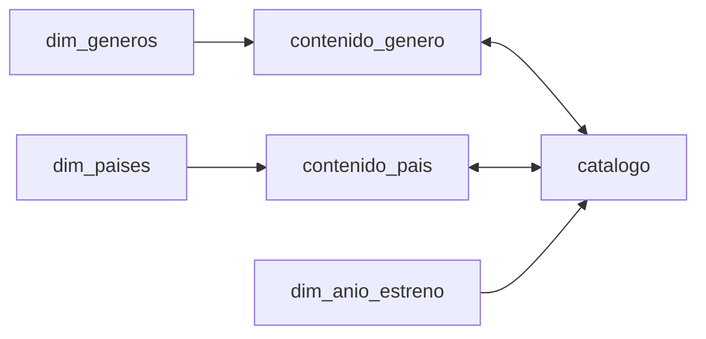

# Modelo e indicadores para Power BI

## Modelo acordado

Importar las seis tablas analíticas de `data/processed/` usando exactamente los nombres de tabla indicados abajo. La unidad de análisis es un contenido (`catalogo[content_id]`), no una asociación de género o país.

| Lado 1 | Lado muchos | Cardinalidad | Dirección de filtro | Activa |
| --- | --- | --- | --- | --- |
| `dim_generos[genre_id]` | `contenido_genero[genre_id]` | 1:* | Única: dimensión hacia asociación | Sí |
| `catalogo[content_id]` | `contenido_genero[content_id]` | 1:* | Ambas | Sí |
| `dim_paises[country_id]` | `contenido_pais[country_id]` | 1:* | Única: dimensión hacia asociación | Sí |
| `catalogo[content_id]` | `contenido_pais[content_id]` | 1:* | Ambas | Sí |
| `dim_anio_estreno[release_year]` | `catalogo[release_year]` | 1:* | Única: dimensión hacia catálogo | Sí |

Las dos relaciones bidireccionales permiten que las tablas de asociación filtren el catálogo. Se restringen a esas relaciones; no activar «Ambas» en todas las relaciones ni añadir relaciones directas entre dimensiones. Esta topología tiene un único recorrido entre tablas. Eliminar relaciones automáticas adicionales y comprobar que Power BI no marque rutas ambiguas.



Las relaciones son 1:*; no utilizar cardinalidad muchos a muchos directamente ni unir las asociaciones a una tabla plana. Desactivar fecha/hora automática para este modelo: el análisis temporal usa año de estreno, no un calendario inferido de incorporación.

## Filtros y comportamiento esperado

- Tipo: `catalogo[type]`.
- Género: `dim_generos[genre]`.
- País: `dim_paises[country]`.
- Idioma: `catalogo[language]`.
- Año de estreno: `dim_anio_estreno[release_year]`.
- Revisión financiera: `catalogo[budget_review_required]`, en la página financiera.

Varias selecciones dentro del mismo filtro significan **cualquiera de las opciones**. Filtros entre dimensiones se combinan por **intersección**: Drama + Japón representa títulos asociados a Drama y Japón. Una coproducción figura en cada país, pero una tarjeta de total cuenta cada contenido una sola vez. La suma de barras por país o género puede superar el total general.

Los segmentadores de dimensiones pueden mostrar categorías sin resultados bajo otros filtros porque el filtro no vuelve hacia esas dimensiones. Es aceptable mantener opciones visibles y mostrar un estado sin datos. Si se desea limitar opciones, aplicar `[Total contenidos] > 0` como filtro visual del segmentador y comprobar la experiencia en el paso 5.

Para rankings, tablas y dispersión, incluir `content_id` como identificador/detalle y título como etiqueta: títulos iguales pueden identificar obras distintas. Aplicar `[Mostrar contenido] = 1` a tablas que solo contengan columnas. Desactivar «Mostrar elementos sin datos». Evitar agregaciones implícitas en tarjetas y gráficos; utilizar las medidas explícitas.

## Medidas y decisiones

El archivo `dashboard/medidas.dax` contiene **23 medidas** para crear individualmente en la tabla `catalogo`. Las medidas con `KEEPFILTERS` intersectan condiciones con las selecciones actuales: seleccionar series no debe devolver películas en las tarjetas financieras.

| Grupo | Indicadores | Formato / interpretación |
| --- | --- | --- |
| Catálogo | Total, películas, series, porcentaje de películas | Enteros / porcentaje. Conteo distinto de clave compuesta. |
| Diversidad | Géneros, países e idiomas presentes | Enteros. Excluyen «Sin información» y nulos. No miden diversidad de consumo. |
| Popularidad | Mediana, popularidad de género con muestra suficiente | Decimal. Índice relativo, sin unidades de reproducción. Umbral de 25 títulos por género. |
| Valoración | Promedio válido, contenidos valorados, cobertura | Decimal en escala 0–10 / entero / porcentaje. Excluye calificaciones cero. Promedio por título, sin ponderación por votos. |
| Votos y rankings | Votos registrados, contenidos elegibles | Enteros. Los votos no equivalen a usuarios únicos. Elegibilidad requiere valoración positiva y 100 votos. |
| Finanzas | Películas válidas, cobertura, presupuesto promedio, sumas de presupuesto e ingresos, razón agregada | Solo películas con ambas métricas positivas; la misma población en numerador y denominador. Unidad monetaria no documentada. |
| Calidad financiera | Películas en revisión, películas financieras en revisión | Enteros. La primera incluye películas sin ingresos; la segunda pertenece al universo financiero válido. |
| Soporte visual | Mostrar contenido | Bandera para filtrar tablas bajo el contexto seleccionado. |

Usar formato porcentaje con un decimal para coberturas y porcentajes; calificación con dos decimales; popularidad y razón con dos decimales. Mantener cifras financieras completas en información sobre herramientas y no agregar símbolo de moneda. La razón agregada es `SUM(revenue) / SUM(budget)`, distinta del promedio de razones por título.

Los conteos devuelven cero ante un segmento vacío; promedios, medianas y razones sin denominador devuelven BLANK. Mostrar «Sin datos» en ese caso, sin sustituirlo por cero. En la página financiera mostrar cobertura sobre películas, no sobre todo el catálogo. Si se filtran series, la cobertura financiera queda sin datos.

## Rankings y gráficos previstos

- Popularidad: Top 10 por popularidad; conservar tipo, calificación y votos como contexto.
- Valoración: filtrar `rating_rank_eligible = TRUE`, ordenar por calificación descendente y usar votos como desempate.
- Géneros: barras por mediana usando la medida con mínimo de 25 títulos; excluir «Sin información».
- Finanzas: ranking por `revenue_budget_ratio`, con `has_valid_financials = TRUE`; mostrar presupuesto, ingresos y bandera de revisión. No ocultar anomalías sin indicarlo.
- Estrenos: línea por año con `[Total contenidos]`; su título será «Contenidos por año de estreno», no «Crecimiento de usuarios» ni «Incorporación a la plataforma».
- Dispersión: popularidad y valoración a nivel de contenido; finanzas a nivel de película válida. Utilizar escala adecuada y mostrar muestra/cobertura.

La selección Top N se realiza en el visual; no se define un ranking global que ignore los filtros. El dashboard será exploratorio. No se incluye un puntaje automático de adquisición o campañas: esas decisiones requieren explicar criterios y limitaciones.

## Control de implementación

`src/referencias_kpis.py` genera `data/processed/referencia_kpis.csv` con indicadores calculados en Python para varios contextos: total, cada tipo, género, país, intersección, multiselección, rango temporal, revisión financiera y segmento vacío.

```bash
python src/main.py
python src/referencias_kpis.py
```

Comparar los conteos exactamente y los decimales con la precisión de presentación. `reference_cases.json` identifica las selecciones de cada caso. No importar las referencias como tablas del modelo. Tras cambiar fuentes, ejecutar ambos scripts en ese orden.

La definición queda preparada, pero las medidas DAX todavía deben ejecutarse en el archivo Power BI durante la construcción y validación. La comparación en Python no verifica por sí sola la configuración de relaciones o el comportamiento de DAX.

## Fundamento técnico

La estructura de asociaciones y la propagación controlada siguen la guía oficial de Microsoft sobre [relaciones de muchos a muchos mediante tablas puente](https://learn.microsoft.com/en-us/power-bi/guidance/relationships-many-to-many). `KEEPFILTERS` conserva la intersección con selecciones existentes, según su [documentación DAX](https://learn.microsoft.com/en-us/dax/keepfilters-function-dax). Esta propuesta aplica esas funciones al alcance concreto del catálogo entregado.
